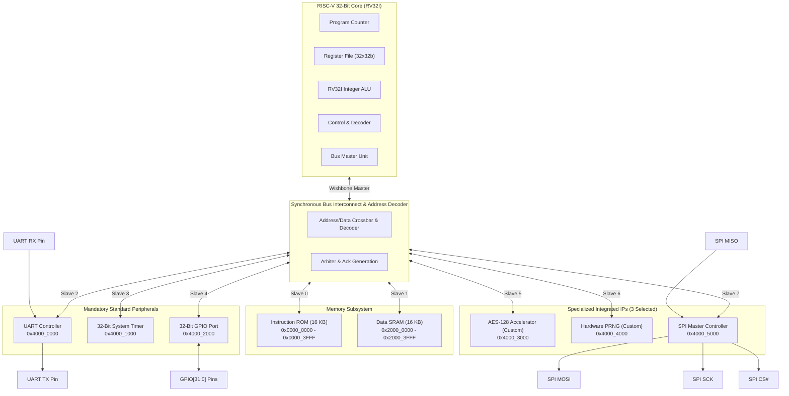

# System-on-Chip (SoC) Architecture Specification
## Configurable AES-128 RISC-V SoC with Hardware PRNG and SPI

---

## 1. System Overview
This document specifies the complete hardware architecture, memory organization, register-level interfaces, and bus protocols for an RTL-based System-on-Chip (SoC) centered on a 32-bit RISC-V processor. 

The SoC incorporates mandatory processing, memory, and peripheral components alongside three specialized IP blocks:
1. **AES-128 Encryption/Decryption Accelerator (Custom IP)**: A hardware cryptographic coprocessor capable of 10-round iterative AES transformations with automated key scheduling.
2. **Pseudo-Random Number Generator (PRNG, Custom IP)**: A 32-bit hardware PRNG combining Galois LFSR and Xorshift primitives for cryptographic salting, IV creation, and nonce generation.
3. **SPI Master Controller (Integrated IP)**: A high-throughput serial engine with programmable clock division and mode configuration for streaming encrypted payloads off-chip.

---

## 2. SoC Block Diagram



### Detailed Structural Block Diagram
```
+-------------------------------------------------------------------------------------------------------+
|                                        RISC-V AES-128 SoC                                             |
|                                                                                                       |
|  +-------------------------+                                                                          |
|  |     RISC-V RV32I Core   |                                                                          |
|  |  +-------------------+  |                                                                          |
|  |  | 32x32 Reg File    |  |                                                                          |
|  |  +-------------------+  |                                                                          |
|  |  | 32-bit ALU        |  |                                                                          |
|  |  +-------------------+  |                                                                          |
|  |  | Instruction Dec   |  |                                                                          |
|  |  +-------------------+  |                                                                          |
|  |  | Wishbone Master   |  |                                                                          |
|  +------------+------------+                                                                          |
|               |                                                                                       |
|               | Wishbone Master Interface (ADR[31:0], DAT_MOSI[31:0], DAT_MISO[31:0], CYC, STB, WE)  |
|               v                                                                                       |
|  +-------------------------------------------------------------------------------------------------+  |
|  |                              SYNCHRONOUS BUS INTERCONNECT / CROSSBAR                            |  |
|  |                                   (Address Decoder & Ack Mux)                                   |  |
|  +---+-------------+-------------+-------------+-------------+-------------+-------------+---------+  |
|      |             |             |             |             |             |             |            |
|      v             v             v             v             v             v             v            |
|  +-------+     +-------+     +-------+     +-------+     +-------+     +-------+     +-------+        |
|  |  ROM  |     |  RAM  |     | UART  |     | TIMER |     | GPIO  |     |  AES  |     | PRNG  |        |
|  | 16 KB |     | 16 KB |     | Ctrl  |     | 32-b  |     | 32-b  |     |  128  |     | 32-b  |        |
|  +-------+     +-------+     +---+---+     +---+---+     +---+---+     +---+---+     +---+---+        |
|                                  |             |             |             |             |            |
|      +---------------------------+             |             |             |             |            |
|      v                                         v             v             |             v            |
|  +-------+                                  [Timer IRQ]   [Pins]           |       [Random Nonce]     |
|  |  SPI  |                                                   |             v                          |
|  | Master|                                                   |      +---------------+                 |
|  +---+---+                                                   |      | 10-Round Core |                 |
|      |                                                       |      | SubBytes      |                 |
|      v                                                       v      | ShiftRows     |                 |
|  [SPI Pins]                                             [GPIO Pins] | MixColumns    |                 |
|  (SCK, MOSI,                                                        | AddRoundKey   |                 |
|   MISO, CS#)                                                        | Key Expansion |                 |
|                                                                     +---------------+                 |
+-------------------------------------------------------------------------------------------------------+
```

---

## 3. SoC Memory Map

The system uses a unified 32-bit byte-addressed memory map. Memory and peripheral spaces are partitioned as follows:

| Region Name | Base Address | End Address | Size | Access | Description |
|:---|:---:|:---:|:---:|:---:|:---|
| **Instruction ROM** | `0x0000_0000` | `0x0000_3FFF` | 16 KB | R / X | Bootloader, vector table, code segments |
| **Data SRAM** | `0x2000_0000` | `0x2000_3FFF` | 16 KB | R / W | Heap, stack, application data |
| **UART Controller** | `0x4000_0000` | `0x4000_00FF` | 256 B | R / W | Serial console interface |
| **Timer Peripheral** | `0x4000_1000` | `0x4000_10FF` | 256 B | R / W | 32-bit counter, prescaler, compare IRQ |
| **GPIO Controller** | `0x4000_2000` | `0x4000_20FF` | 256 B | R / W | 32-bit digital input/output & direction |
| **AES-128 Accelerator** | `0x4000_3000` | `0x4000_30FF` | 256 B | R / W | Cryptographic key, input/output & control |
| **Hardware PRNG** | `0x4000_4000` | `0x4000_40FF` | 256 B | R / W | 32-bit pseudo-random generator & seed |
| **SPI Controller** | `0x4000_5000` | `0x4000_50FF` | 256 B | R / W | SPI master control, status, TX/RX buffer |
| *Reserved* | `0x4000_6000` | `0xFFFF_FFFF` | - | - | Unmapped (decodes to bus error) |

---

## 4. Register Interface Specifications

All peripheral registers are 32-bit wide, aligned on 4-byte boundaries (offsets are multiples of `0x04`).

### 4.1 UART Controller (`BASE = 0x4000_0000`)
| Offset | Name | Type | Reset Value | Description |
|:---:|:---:|:---:|:---:|:---|
| `0x00` | `UART_DATA` | R/W | `0x0000_0000` | Bits [7:0]: Read for RX character, Write for TX character |
| `0x04` | `UART_STATUS` | RO | `0x0000_0002` | Bit 0: `RX_VALID` (1=RX byte ready), Bit 1: `TX_READY` (1=TX idle, can accept byte) |
| `0x08` | `UART_CTRL` | R/W | `0x0000_0003` | Bit 0: `TX_EN`, Bit 1: `RX_EN`, Bit 2: `RX_IRQ_EN`, Bit 3: `TX_IRQ_EN` |
| `0x0C` | `UART_BAUDDIV` | R/W | `0x0000_01B2` | 16-bit clock divisor for baud rate calculation ($Div = \frac{F_{clk}}{16 \times Baud}$) |

### 4.2 32-Bit System Timer (`BASE = 0x4000_1000`)
| Offset | Name | Type | Reset Value | Description |
|:---:|:---:|:---:|:---:|:---|
| `0x00` | `TIMER_COUNT` | R/W | `0x0000_0000` | Current 32-bit timer counter value |
| `0x04` | `TIMER_COMPARE` | R/W | `0xFFFF_FFFF` | 32-bit compare threshold for match/interrupt |
| `0x08` | `TIMER_CTRL` | R/W | `0x0000_0000` | Bit 0: `ENABLE`, Bit 1: `AUTO_RELOAD`, Bit 2: `IRQ_EN`, Bit 3: `MATCH_FLAG` (W1C) |
| `0x0C` | `TIMER_PRESCALE`| R/W | `0x0000_0000` | 16-bit clock prescaler ($Tick = Prescale + 1$) |

### 4.3 GPIO Controller (`BASE = 0x4000_2000`)
| Offset | Name | Type | Reset Value | Description |
|:---:|:---:|:---:|:---:|:---|
| `0x00` | `GPIO_INPUT` | RO | `0x0000_0000` | Current logic levels sampled on physical pins [31:0] |
| `0x04` | `GPIO_OUTPUT` | R/W | `0x0000_0000` | Output drive values for pins [31:0] |
| `0x08` | `GPIO_DIR` | R/W | `0x0000_0000` | Pin direction: 1 = Output, 0 = Input |
| `0x0C` | `GPIO_SET` | WO | `0x0000_0000` | Atomic bit set: writing 1 sets corresponding output bit |
| `0x10` | `GPIO_CLEAR` | WO | `0x0000_0000` | Atomic bit clear: writing 1 clears corresponding output bit |

### 4.4 AES-128 Encryption/Decryption Accelerator (`BASE = 0x4000_3000`)
The AES accelerator features a dedicated 128-bit key interface (four 32-bit registers), 128-bit input data interface (four 32-bit registers), and 128-bit output result interface (four 32-bit registers).

| Offset | Name | Type | Reset Value | Description |
|:---:|:---:|:---:|:---:|:---|
| `0x00` | `AES_CTRL` | R/W | `0x0000_0000` | Bit 0: `START` (W1S, self-clearing pulse), Bit 1: `MODE` (0=Encrypt, 1=Decrypt), Bit 2: `SOFT_RESET`, Bit 3: `IRQ_EN` |
| `0x04` | `AES_STATUS` | RO | `0x0000_0000` | Bit 0: `BUSY` (1=operation in progress), Bit 1: `DONE` (1=operation finished, W1C), Bit 2: `VALID` (1=result valid in DOUT registers) |
| `0x08` | `AES_KEY0` | R/W | `0x0000_0000` | Key Word 0 (Bits [127:96]) |
| `0x0C` | `AES_KEY1` | R/W | `0x0000_0000` | Key Word 1 (Bits [95:64]) |
| `0x10` | `AES_KEY2` | R/W | `0x0000_0000` | Key Word 2 (Bits [63:32]) |
| `0x14` | `AES_KEY3` | R/W | `0x0000_0000` | Key Word 3 (Bits [31:0]) |
| `0x18` | `AES_DIN0` | R/W | `0x0000_0000` | Input Block Word 0 (Bits [127:96]) |
| `0x1C` | `AES_DIN1` | R/W | `0x0000_0000` | Input Block Word 1 (Bits [95:64]) |
| `0x20` | `AES_DIN2` | R/W | `0x0000_0000` | Input Block Word 2 (Bits [63:32]) |
| `0x24` | `AES_DIN3` | R/W | `0x0000_0000` | Input Block Word 3 (Bits [31:0]) |
| `0x28` | `AES_DOUT0` | RO | `0x0000_0000` | Result Block Word 0 (Bits [127:96]) |
| `0x2C` | `AES_DOUT1` | RO | `0x0000_0000` | Result Block Word 1 (Bits [95:64]) |
| `0x30` | `AES_DOUT2` | RO | `0x0000_0000` | Result Block Word 2 (Bits [63:32]) |
| `0x34` | `AES_DOUT3` | RO | `0x0000_0000` | Result Block Word 3 (Bits [31:0]) |

### 4.5 Hardware PRNG (`BASE = 0x4000_4000`)
| Offset | Name | Type | Reset Value | Description |
|:---:|:---:|:---:|:---:|:---|
| `0x00` | `PRNG_SEED` | WO | `0xACE1_2468` | 32-bit Seed injection register |
| `0x04` | `PRNG_CTRL` | R/W | `0x0000_0001` | Bit 0: `ENABLE` (1=running), Bit 1: `LOAD_SEED` (pulse to reseed), Bit 2: `ALGO_SEL` (0=Galois LFSR, 1=Xorshift32) |
| `0x08` | `PRNG_STATUS`| RO | `0x0000_0001` | Bit 0: `READY` (1=new random value ready) |
| `0x0C` | `PRNG_DATA` | RO | `0x0000_0000` | Current 32-bit pseudo-random output word (reading advances sequence) |

### 4.6 SPI Master Controller (`BASE = 0x4000_5000`)
| Offset | Name | Type | Reset Value | Description |
|:---:|:---:|:---:|:---:|:---|
| `0x00` | `SPI_DATA` | R/W | `0x0000_0000` | Write: Transmit byte [7:0] onto SPI; Read: Received byte [7:0] |
| `0x04` | `SPI_STATUS` | RO | `0x0000_0002` | Bit 0: `BUSY` (1=transfer in progress), Bit 1: `TX_EMPTY` (1=buffer empty), Bit 2: `RX_READY` (1=byte received) |
| `0x08` | `SPI_CTRL` | R/W | `0x0000_0000` | Bit 0: `ENABLE`, Bit 1: `CS_N` (software control of chip select: 0=Asserted, 1=Deasserted), Bit 2: `CPOL`, Bit 3: `CPHA` |
| `0x0C` | `SPI_CLKDIV` | R/W | `0x0000_0008` | 16-bit SCK divider: $f_{SCK} = \frac{f_{clk}}{2 \times (CLKDIV + 1)}$ |

---

## 5. Bus Protocol Specifications

The system interconnect adheres to the standard synchronous pipelined **Wishbone B4** / **AMBA AHB-Lite compatible** memory interface specification.

### 5.1 Bus Signal Definitions
| Signal Name | Direction (Master $\rightarrow$ Slave) | Width | Description |
|:---|:---:|:---:|:---|
| `CLK_I` | In | 1 | Master system clock (all transfers are synchronous to rising edge) |
| `RST_I` | In | 1 | Active-high synchronous reset |
| `ADR_I` | Master $\rightarrow$ Slave | 32 | Byte-address bus |
| `DAT_I` | Master $\rightarrow$ Slave | 32 | Write data bus (Master out, Slave in) |
| `DAT_O` | Slave $\rightarrow$ Master | 32 | Read data bus (Slave out, Master in) |
| `WE_I`  | Master $\rightarrow$ Slave | 1  | Write enable (1 = Write transfer, 0 = Read transfer) |
| `SEL_I` | Master $\rightarrow$ Slave | 4  | Byte lane enables: `SEL[0]` (bits [7:0]) through `SEL[3]` (bits [31:24]) |
| `STB_I` | Master $\rightarrow$ Slave | 1  | Strobe: indicates active transaction for selected slave |
| `CYC_I` | Master $\rightarrow$ Slave | 1  | Cycle: indicates valid bus cycle in progress |
| `ACK_O` | Slave $\rightarrow$ Master | 1  | Acknowledge: asserted by addressed slave to complete transfer |

### 5.2 Read Transaction Protocol
A read transaction initiates when the Master drives `ADR_I`, deasserts `WE_I` (0), drives byte enables `SEL_I`, and asserts `CYC_I` and `STB_I`.
1. **Cycle 1 (Address Phase)**: Address and control signals are driven. The central interconnect decodes `ADR_I[31:24]` to generate individual slave select strobes.
2. **Cycle 2 (Data Phase / Zero-Wait or Wait-State)**: The addressed slave reads the internal register/memory location and asserts `ACK_O` along with valid data on `DAT_O`.
3. **Termination**: Master samples `DAT_O` on the rising clock edge where `ACK_O` is asserted, and deasserts `STB_I` and `CYC_I`.

```
CLK_I     : __/--\__/--\__/--\__/--\__/--\__
ADR_I     : ==<  ADDR 0x4000_3004  >========
CYC_I     : ____/--------------------\______
STB_I     : ____/--------------------\______
WE_I      : ________________________________ (Read = 0)
ACK_O     : ____________/------------\______
DAT_O     : ============<   DATA   >========
```

### 5.3 Write Transaction Protocol
A write transaction occurs when the Master drives `ADR_I`, `DAT_I`, byte enables `SEL_I`, asserts `WE_I` (1), and drives `CYC_I` and `STB_I` high.
1. The addressed slave captures `DAT_I` into the target register on the clock edge where `STB_I` and `WE_I` are active.
2. The slave asserts `ACK_O` to confirm reception.
3. Master terminates the transfer by lowering `STB_I` and `CYC_I`.

```
CLK_I     : __/--\__/--\__/--\__/--\__/--\__
ADR_I     : ==<  ADDR 0x4000_3000  >========
DAT_I     : ==<   DATA 0x00000001  >========
CYC_I     : ____/--------------------\______
STB_I     : ____/--------------------\______
WE_I      : ____/--------------------\______ (Write = 1)
ACK_O     : ____________/------------\______
```

### 5.4 Address Decoding Logic
The central interconnect uses the upper address bits `ADR_I[31:12]` to generate chip-select lines:
- `ROM_CS`   : `ADR_I[31:16] == 16'h0000` (16 KB window)
- `RAM_CS`   : `ADR_I[31:16] == 16'h2000` (16 KB window)
- `PERIPH_CS`: `ADR_I[31:16] == 16'h4000`
  - `UART_CS`  : `ADR_I[15:8] == 8'h00`
  - `TIMER_CS` : `ADR_I[15:8] == 8'h10`
  - `GPIO_CS`  : `ADR_I[15:8] == 8'h20`
  - `AES_CS`   : `ADR_I[15:8] == 8'h30`
  - `PRNG_CS`  : `ADR_I[15:8] == 8'h40`
  - `SPI_CS`   : `ADR_I[15:8] == 8'h50`

If an unmapped address is accessed, the interconnect responds with a default single-cycle acknowledgment returning `0xDEADBEEF` to prevent the processor pipeline from stalling permanently.
